# MobileFood

A food-ordering desktop app written in Java with JavaFX. A central server connects
**restaurant** clients and **customer** clients over sockets (port 12345). Restaurants manage
their menu and orders; customers search for restaurants and food, order, and chat.

## Screenshots

### Customer app

<table>
<tr><td align="center"><br><sub>Login</sub></td><td align="center">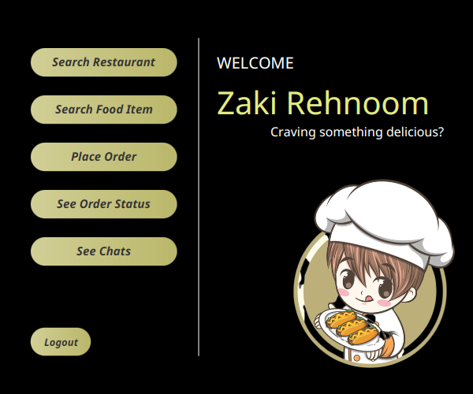<br><sub>Customer home</sub></td><td align="center">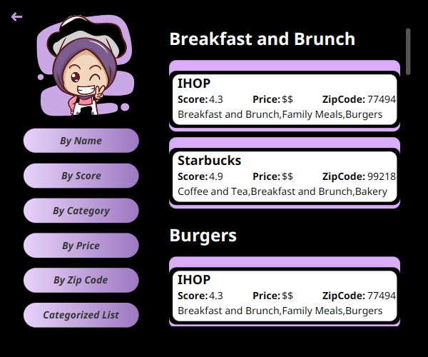<br><sub>Browse restaurants</sub></td></tr>
<tr><td align="center">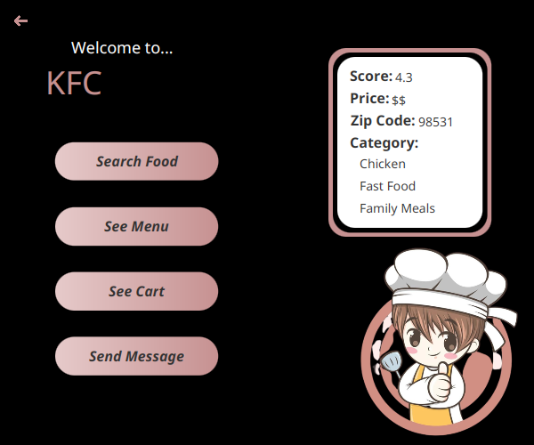<br><sub>Restaurant profile</sub></td><td align="center">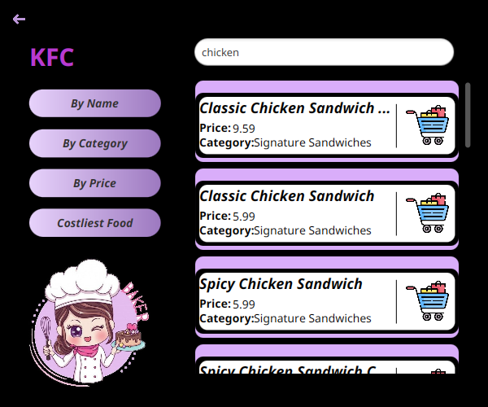<br><sub>Live food search</sub></td><td align="center">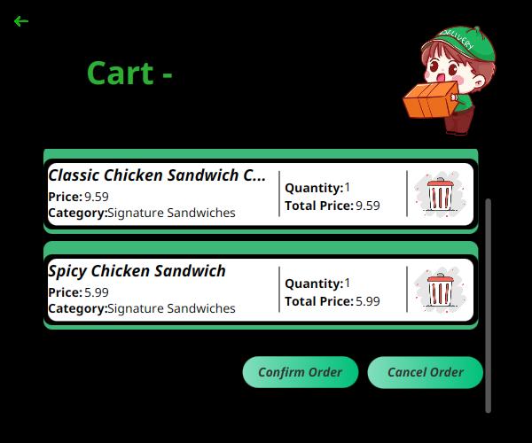<br><sub>Cart</sub></td></tr>
<tr><td align="center">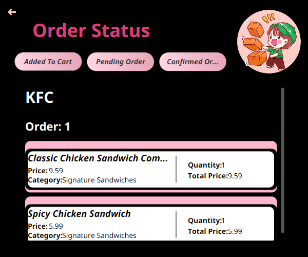<br><sub>Order status</sub></td><td align="center">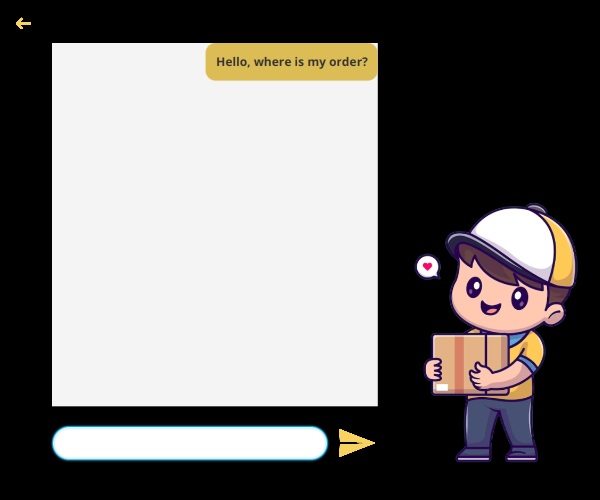<br><sub>Chat with the restaurant</sub></td></tr>
</table>

### Restaurant app

<table>
<tr><td align="center">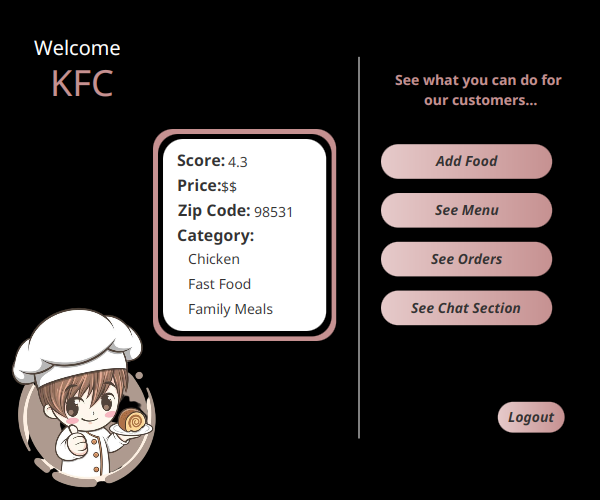<br><sub>Restaurant home</sub></td><td align="center">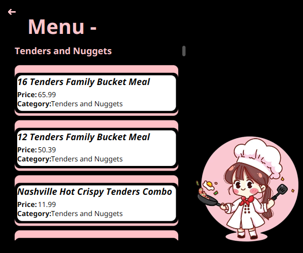<br><sub>Menu</sub></td><td align="center">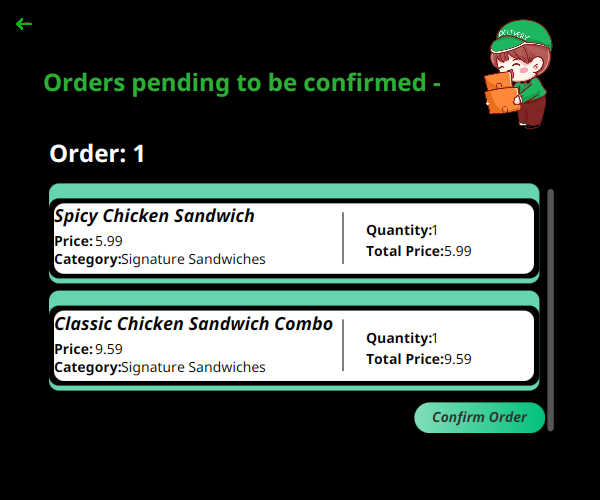<br><sub>Incoming orders</sub></td></tr>
<tr><td align="center">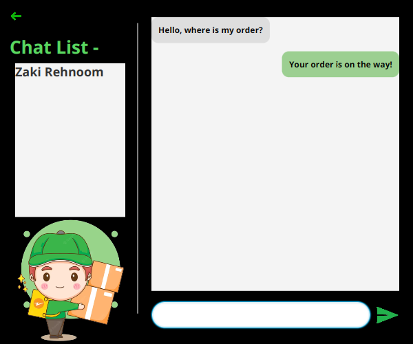<br><sub>Chat with customers</sub></td></tr>
</table>

## Requirements
- JDK 17 or newer
- JavaFX (OpenJFX)
  - Ubuntu/Debian: `sudo apt install openjfx`
  - macOS: `brew install openjfx`
  - Otherwise download the SDK from <https://gluonhq.com/products/javafx/> and set
    `JAVAFX_LIB=/path/to/javafx-sdk/lib` before running the commands below.

## Run
Open three terminals in the project folder:

```bash
./run.sh server       # 1. start first and keep it running
./run.sh restaurant   # 2. restaurant app
./run.sh customer     # 3. customer app
```

You can start as many restaurant and customer apps as you like. The script compiles
automatically when sources change. `./run.sh build` only compiles, `./run.sh clean` removes the
build output (`out/`).

If you get "Permission denied", run `chmod +x run.sh` or start it with `bash run.sh server`.
Console warnings from JavaFX (version mismatch, `Unsafe`) are harmless.

## First run
The server stores its data in plain text files in `datafiles/` (`restaurant.txt`, `customer.txt`,
`menu.txt`). That folder is not part of the repository: the server creates it, empty, the first
time it starts, so a fresh copy starts with no restaurants and no accounts.

1. In the restaurant app, register a restaurant and add some food to its menu.
2. In the customer app, register an account, find the restaurant, add food to the cart and order.
3. Use the order pages and the chat on both sides.

Always start the server from the project folder (`./run.sh` does this), because `datafiles/` is
resolved relative to it. To reset everything, stop the server and delete `datafiles/`.

## Layout
- `src/mobilefood/Server.java` - the server
- `src/mobilefood/restaurant`, `src/mobilefood/customer` - the two JavaFX apps (controllers and FXML)
- `src/mobilefood/passableobjects` - objects sent over the network
- `src/networking` - socket wrapper and read threads
- `src/images` - images, loaded from the classpath (`characters/`, `backarrows/`, `utils/`)
- `src/styles` - stylesheets: button colour themes and the scrollbar style
- `datafiles/` - runtime data, created by the server (git-ignored)
- `docs/screenshots` - the screenshots shown above

## Windows
`run.sh` needs a bash shell (Git Bash or WSL). Otherwise compile and run by hand with
`javac`/`java` and `--module-path <javafx>\lib --add-modules javafx.controls,javafx.fxml`, using
`out` as the output folder and classpath, and copying the `.fxml` and `.css` files and the `images`
folder from `src` into `out`. Run `mobilefood.Server`, `mobilefood.restaurant.RestaurantMain` or
`mobilefood.customer.CustomerMain` from the project folder.

## Credits
The character and icon images are third-party artwork (e.g. Freepik) used for educational purposes.
